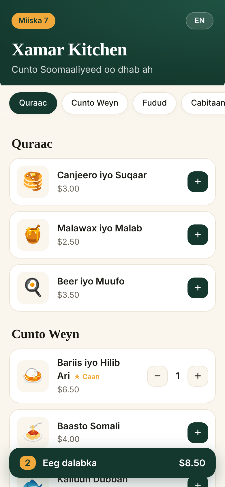
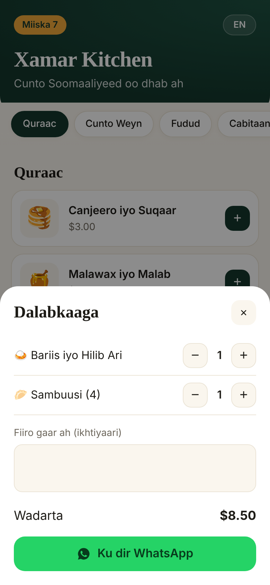

# qr-smart-menu

**Scan the table, pick your food, order on WhatsApp.** A mobile menu for restaurants and cafés: each table gets a QR code, customers browse in Somali or English, and the finished order arrives on the restaurant's WhatsApp with the table number.

No app to install, no backend, no monthly fees. Host it free on GitHub Pages, Vercel or any static host.


<p align="center">
  
  &nbsp;&nbsp;
  
</p>

## How it works

1. Print a QR code per table with [`qr.html`](public/qr.html); each one opens the menu with `?table=N`.
2. The customer scans, adds dishes, and taps **Ku dir WhatsApp**.
3. WhatsApp opens with the order pre-written:

   ```
   🧾 Dalab cusub — Miiska 7

   • 1 × Bariis iyo Hilib Ari — $6.50
   • 1 × Sambuusi (4) — $2.00

   Wadarta: $8.50
   ```

4. The waiter or kitchen receives it on the restaurant's number.

## Features

- Somali / English with one tap (remembered per device)
- Sticky category tabs, quantity steppers, live total
- Optional note for the kitchen ("basbaas la'aan")
- Light and dark mode, safe-area aware for modern phones
- Printable QR sheet generator for any number of tables
- Money maths in integer cents, so no `0.1 + 0.2` surprises
- Table parameter validated so a crafted QR can't inject content

## Make it yours

Edit [`public/menu.json`](public/menu.json): restaurant name, WhatsApp number (international format, no `+`), currency, categories and items. That's it.

```json
{ "id": "m1", "name": { "so": "Bariis iyo Hilib Ari", "en": "Rice with Goat Meat" }, "price": 6.5, "emoji": "🍛", "popular": true }
```

## Run locally

```bash
npm start         # serves ./public
npm test          # cart and order-message tests
```

## Deploy

Point any static host at the `public/` folder, e.g. GitHub Pages (Settings → Pages → deploy from `/public` via an action), Vercel or Netlify.

## Roadmap

- [ ] Pay at the table with EVC Plus / Zaad / Sahal via [somali-payments](https://github.com/abdimalikhussein25/somali-payments)
- [ ] Kitchen dashboard instead of WhatsApp for busy restaurants
- [ ] Item photos and sold-out toggle

## License

MIT © Abdimalik Salad Hussein · [Fiddo Technology](https://fiddotechnology.com)
